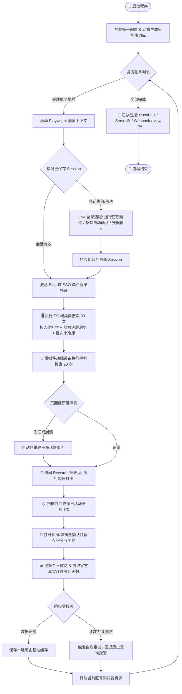

# 🌟 Bing Rewards Pro

<div align="center">


**现代化、高韧性、抗风控的 Microsoft Bing Rewards 全自动化积分收割与连续签到系统**

[功能特性](#-核心特性与技术优势) • [快速上手](#-快速上手) • [部署方案](#-部署方案) • [配置说明](#-配置完全指南) • [常见问题](#-常见问题-faq)

</div>

---

## 📖 项目简介

**Bing Rewards Pro** 是针对微软 Rewards 积分体系深度定制的现代化自动化工具。不同于传统容易崩溃的 Selenium 脚本，本项目基于 **Playwright** 工业级自动化内核构建，彻底重构了登录认证、页面调度、热词生成及交互逻辑。

专为 **低内存 VPS（如 1C1G）、本地多平台环境以及 GitHub Actions 无服务器托管** 设计，具备极强的网络容错与页面自愈能力，助您稳定、安全、零人工干预地获取每日满额积分并维持连续签到记录。

---

## ✨ 核心特性与技术优势

| 功能特性 | 传统自动化脚本 | Bing Rewards Pro |
| :--- | :--- | :--- |
| **底层驱动引擎** | Selenium / Chromedriver (版本易冲突、易卡死) | **Playwright 原生内核** (极速稳定、沙箱隔离、开箱即用) |
| **多端搜索覆盖** | 仅支持 PC 搜索，损失近 40% 积分 | **PC 端 (90分) + 移动端模拟 (60分)** 全额拿满 |
| **登录与凭据管理** | 每次重复输入账号密码，极易触发风控验证 | **Session / Cookie 持久化** + **静默 SSO 免密直通** |
| **通行密钥绕过** | 遇到 WebAuthn 通行密钥死锁弹窗即任务挂起 | **智能识别弹窗**，自动绕过并平滑回退密码登录 |
| **活动卡片与暂存箱** | 容易漏点、不支持新版 FluentUI 抽屉弹窗 | **自动展开手风琴面板**，原生 DOM 物理穿透点击与暂存箱全额认领 |
| **官方打卡天数解析** | 本地累加计算（极易因断签或偶发失败产生误差） | **DOM 树 + 内嵌 JSON 双重解析**，100% 对齐官方真实打卡天数 |
| **系统韧性与自愈** | 长时间运行遇内存告警或崩溃直接死锁报错 | **活跃页面健康探测 (Self-Healing)**，遇崩溃热重连与防归零保护 |
| **热词与防风控** | 固定生硬词表、机械化快速连搜 | **Bing 联想 API + 智能组合词库**，拟人化滚动、视口停留与批次微休眠 |
| **监控与结果通知** | 仅控制台文本输出，无法远程获知结果 | 支持 **PushPlus、Server酱、自定义 Webhook** 及私有监控大盘 API |

---

## 🔄 自动化工作流架构



---

## 🚀 快速上手

### 1. 环境准备

推荐使用 **Python 3.8 ~ 3.12** 环境：

```bash
# 克隆本仓库
git clone https://github.com/lockezhan/Bing-Reward-auto.git
cd Bing-Reward-auto

# 安装核心依赖
pip install -r requirements.txt

# 安装 Playwright 专用 Chromium 浏览器内核及系统依赖
playwright install --with-deps chromium
```

### 2. 配置账号

复制模板生成 `accounts.json`（该文件已内置于 `.gitignore`，绝不上传）：

```bash
cp config/accounts.example.json accounts.json
```

编辑 `accounts.json`，配置一个或多个微软账号：

```json
{
  "accounts": [
    {
      "email": "your_account@outlook.com",
      "password": "your_password"
    }
  ]
}
```

> 💡 **提示**：系统同时向下兼容字典分组格式（例如 `{"group1": [{"email": "...", "password": "..."}]}`）。对于已生成 `.sessions/` 登录缓存的账号，密码可为空，实现纯 Session 免密打卡。

### 3. 运行体验

```bash
# 单次全流程执行（PC搜索 + 移动搜索 + 每日签到 + 任务卡片）
python main.py --once

# 有头可视化模式（排查登录问题或首次观察时推荐）
python main.py --no-headless

# 仅执行每日签到与卡片，跳过搜索
python main.py --skip-search

# 仅测试指定账号（支持模糊匹配）
python main.py --account your_account@outlook.com
```

---

## 🛠️ 部署方案

### 方案 A：GitHub Actions 无服务器云端自动化（强烈推荐 ⭐️）

无需自备服务器，零成本全自动运行：

1. **Fork 本仓库** 到您的个人 GitHub 账号；
2. 进入您 Fork 后的仓库，依次点击 **Settings** ➔ **Secrets and variables** ➔ **Actions**；
3. 点击 **New repository secret**，添加以下环境变量：
   - `ACCOUNTS_CONFIG`（**必填**）：您的 `accounts.json` 完整 JSON 内容字符串。
   - `PUSHPLUS_TOKEN`（可选）：PushPlus 微信推送 Token。
   - `SERVERCHAN_KEY`（可选）：Server酱推送 SendKey。
   - `CUSTOM_WEBHOOK`（可选）：企业微信/钉钉/飞书自定义 Webhook 链接。
   - `DASHBOARD_REPORT_URL`（可选）：自定义大盘汇报地址。
4. **启用定时调度**：进入仓库的 **Actions** 标签页，启用工作流。默认将在每天北京时间 **09:30 (UTC 01:30)** 自动执行，支持在 Actions 页面手动点击 **Run workflow** 随时触发。

---

### 方案 B：Linux VPS / 树莓派无人值守部署

#### 1. 常驻守护进程模式
内置守护进程，直接保持每天指定时间自动执行：

```bash
# 每天 09:30 自动触发
python main.py --daemon --schedule-time 09:30
```

#### 2. 配置 Systemd 系统级后台服务
创建服务定义文件 `/etc/systemd/system/bing-rewards.service`：

```ini
[Unit]
Description=Bing Rewards Pro Automation Daemon
After=network.target

[Service]
Type=simple
User=root
WorkingDirectory=/path/to/Bing-Reward-auto
ExecStart=/path/to/venv/bin/python main.py --daemon --schedule-time 09:30
Restart=always
RestartSec=30
Environment=PYTHONUNBUFFERED=1

[Install]
WantedBy=multi-user.target
```

启动并设置开机自启：

```bash
systemctl daemon-reload
systemctl enable --now bing-rewards.service
systemctl status bing-rewards.service
```

---

## ⚙️ 配置完全指南

### CLI 命令行选项

| 参数 | 类型 | 默认值 | 说明 |
| :--- | :---: | :---: | :--- |
| `--once` | flag | `True` | 单次执行模式（默认） |
| `--daemon` | flag | `False` | 守护进程模式，在后台每日循环执行 |
| `--schedule-time` | string | `09:30` | 守护进程每日执行时间（格式 `HH:MM`） |
| `--no-headless` | flag | `False` | 关闭无头模式，显示真实 Chromium 浏览器窗口 |
| `--skip-search` | flag | `False` | 跳过 PC 和移动端搜索，仅执行打卡、任务卡片与认领 |
| `--pc-only` | flag | `False` | 仅执行 PC 端搜索与签到 |
| `--mobile-only` | flag | `False` | 仅执行移动端搜索与签到 |
| `--pc-count` | int | `30` | PC 端搜索次数（每次通常 3 分，上限 90 分） |
| `--mobile-count` | int | `20` | 移动端搜索次数（每次通常 3 分，上限 60 分） |
| `--account` | string | `""` | 仅运行指定的单个账号（支持邮箱模糊过滤） |

### 环境变量列表

| 变量名 | 默认值 | 作用说明 |
| :--- | :--- | :--- |
| `ACCOUNTS_CONFIG` | 空 | 账号配置的 JSON 文本，优先级高于本地 `accounts.json`（适合云端 Secrets） |
| `HTTP_PROXY` / `http_proxy` | 空 | 自动化浏览器使用的 HTTP/SOCKS 代理地址 |
| `PUSHPLUS_TOKEN` | 空 | [PushPlus](https://www.pushplus.plus/) 微信消息推送 Token |
| `SERVERCHAN_KEY` | 空 | [Server酱](https://sct.ftqq.com/) 微信推送 SendKey |
| `CUSTOM_WEBHOOK` | 空 | 自定义通用 Markdown 格式 Webhook 接收地址 |
| `DASHBOARD_REPORT_URL` | 空 | 积分大盘/私有面板推送接收 URL |
| `DASHBOARD_REPORT_TOKEN`| 空 | 积分大盘私有请求鉴权 Token |

---

## ❓ 常见问题 (FAQ)

### Q1: 提示服务条款更新 (Terms of Use) 或通行密钥 (Passkey) 怎么办？
本系统已集成专属拦截探测处理器 `handle_login_prompts` 与 `bypass_passkey_prompt`。遇到条款更新时会自动确认，遇到通行密钥时会自动跳过并自动切换为密码输入，无需人工介入。

### Q2: 出现网页崩溃 `Page crashed` 会导致进程死锁吗？
不会。系统内置了 `ensure_active_page` 页面健康巡检机制，当由于系统内存紧张或长耗时搜索导致渲染进程崩溃时，会自动销毁故障页面并重建活跃页面重连，同时具备**防归零结算保护**，历史基准绝不丢失。

### Q3: 为什么有时候移动端搜索完成数小于设定值？
系统内置了智能风控冷却机制，如果在搜索过程中遭遇微软频率限制或页面超时，系统会自动记录并微调延时，保护账号不被风控冻结。

---

## 🔒 隐私与安全性

- **零数据上传**：所有账号密码、Session Cookie、缓存仅保存在您本地设备或您私有的 GitHub Secrets 中；
- **全链路脱敏**：控制台输出及推送报告中的邮箱均已进行前缀脱敏（如 `imp***@outlook.com`）；
- **忽略规则完善**：`.gitignore` 严格包含了账号、凭证、日志、截图与本地临时测试文件，绝不发生敏感资产泄漏。

---

## 📄 开源许可证

本项目基于 [MIT License](LICENSE) 开源。仅供自动化测试与个人学习研究使用，请勿用于非法或违反微软服务条款之用途。
